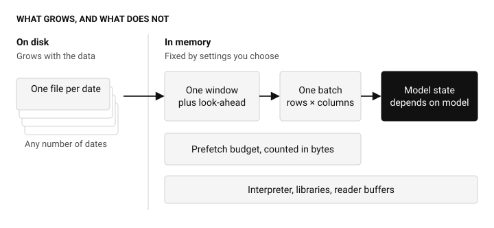
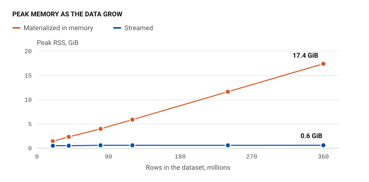
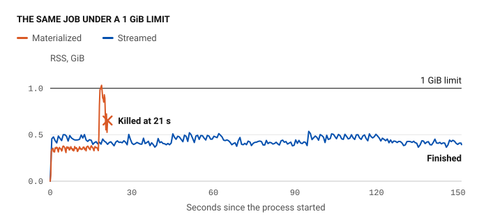
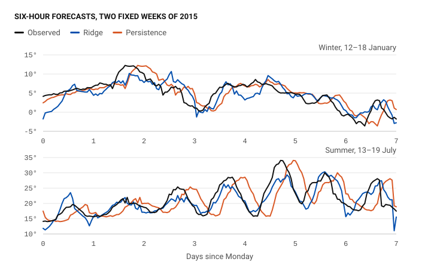
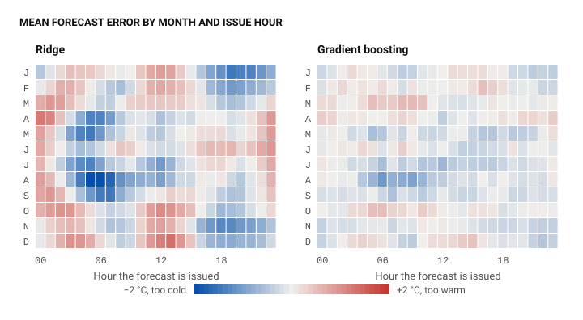
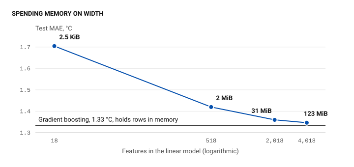

<!-- i18n: gardenpipe.block001 -->

Most people who train models on limited hardware know this failure. You start a promising run, go to bed, and find in the morning that the process was killed 22 minutes after it started. The error names memory, but not the decision that spent it.

<!-- i18n: gardenpipe.block002 -->

That is what makes out-of-memory errors expensive. Peak memory is usually a side effect of the file reader, the feature code, the prefetch queue, and the model, each reasonable on its own. Nobody wrote the number down, so nothing could check it before the run began. The usual remedies work around the problem: a larger machine, a sample of the data, or a cluster for a job that one workstation could do.

<!-- i18n: gardenpipe.block003 -->

GardenPipe starts from a different premise: memory is an input you set, not an output you discover. The name comes from the difference between a fire main and a garden hose. With a fire main there is capacity to spare, and a surge simply goes somewhere. With a garden hose you are watering beds you care about, so you want a steady stream whose rate you control. Data work on one machine is the garden case. The dataset on disk can be many times larger than RAM, and one careless `collect()` floods the machine.

<!-- i18n: gardenpipe.block004 -->

In this note, we describe the memory model rather than the code. We begin with the budget and the question underneath it: what does a training run actually need to remember? We then measure whether the bound holds, up to a billion rows on a machine with 31 GiB of RAM. Finally, we use real weather data to check that streaming does not change the answer, and to assess how good the fit is. That assessment is less flattering than the first table suggests, and it leads back to memory.

<!-- i18n: gardenpipe.block005 -->

**In this note:** [The budget](#budget) · [What to remember](#state) · [Does it hold?](#bound) · [Weather](#weather) · [The fit](#fit) · [Width, not length](#width) · [Limits](#limits)

<!-- i18n: gardenpipe.block006 -->

## Memory as a budget {#budget}

<!-- i18n: gardenpipe.block007 -->

The guarantee is easy to state: growing the dataset adds time, not memory. GardenPipe reads one date at a time, cuts each date into windows of about `batch_size` rows, and hands the model fixed-size batches. Peak memory is then roughly a sum of five terms.

<!-- i18n: gardenpipe.block008 -->

| Term | Set by | Grows with the dates? |
| --- | --- | --- |
| Interpreter and libraries | Your environment | No |
| One window and its look-ahead | Batch size, target horizon | No |
| One batch: rows × columns × 8 bytes | Batch size, feature count | No |
| Prefetch | A budget in bytes | No |
| Model state | The model | Depends on the model |

<!-- i18n: gardenpipe.block009 -->

<figure class="note-figure">
  

  <figcaption>Only the files on the left grow with the data. Everything on the right is set before the run begins, apart from model state, which depends on the model.</figcaption>
</figure>

<!-- i18n: gardenpipe.block010 -->

Two design choices make this more than arithmetic. First, prefetch is budgeted in bytes, not queue slots. A queue of ten batches is not a memory bound, because it says nothing about how large a batch is. Each worker reserves credit before it builds a batch, the credit travels with the batch, and it is released only when the consumer lets go. While a batch exists both as a DataFrame and as NumPy arrays, it is charged twice.

<!-- i18n: gardenpipe.block011 -->

Second, a budget that cannot work fails at the start. If prefetch cannot hold what a pass needs, GardenPipe rejects it before any worker starts. In our test, a 1 MiB budget stopped after 0.2 seconds, with an error stating what it needed: 12 million bytes, or a batch of at most 8,738 rows. That is the same mistake as the failure at minute 22, at a much lower price.

<!-- i18n: gardenpipe.block012 -->

## What has to be remembered {#state}

<!-- i18n: gardenpipe.block013 -->

Streaming is easy. Streaming without changing the answer is the hard part. Cut a dataset into batches naively, and every exponential average restarts at the boundary, every lag goes missing, and every target near the edge disappears. The output looks plausible and is wrong.

<!-- i18n: gardenpipe.block014 -->

The useful question is therefore not how large the data are, but how much of the past each step must keep. A physicist would recognize the idea: a state is the smallest description of the past that makes the future independent of it. GardenPipe looks for such a state for everything that crosses a batch boundary.

<!-- i18n: gardenpipe.block015 -->

| What crosses a boundary | What it must keep | Grows with rows? |
| --- | --- | --- |
| Exponential average | One value and one timestamp | No |
| Lag or rolling window | That much history | No |
| Forward target | One horizon of look-ahead | No |
| Ridge regression | *X′X*, *X′y*, and the means | No |
| Neural network | Weights and optimizer state | No |
| Boosted trees, in core | A quantized copy of the rows | Yes |

<!-- i18n: gardenpipe.block016 -->

The ridge row deserves attention. For a linear model, *X′X* and *X′y* are sufficient statistics: they hold everything the data can tell the model. A billion rows with 20 features compress, without loss, to a 20 × 20 matrix. The result is not an approximation to the full-data solution. It is that solution.

<!-- i18n: gardenpipe.block017 -->

The price is discipline. Files must be sorted by time. Plain feature expressions must be local to a row or a timestamp. Anything that needs history has to be declared as state. We think this is the right trade, because it turns a hidden dependency on the past into a declared one with a known size.

<!-- i18n: gardenpipe.block018 -->

## Does the bound hold? {#bound}

<!-- i18n: gardenpipe.block019 -->

We measured this on generated data: one mean-reverting series at four million rows per day, an exponential average, a five-minute forward target, and ridge regression over walk-forward folds. Each run was a fresh process on a 12-core, 20-thread machine with 31 GiB of RAM. The control is the same pipeline with one flag changed, so that each source is materialized in memory instead of streamed.

<!-- i18n: gardenpipe.block020 -->

| Rows | On disk | Streamed peak | Materialized peak | Streamed time | Materialized time |
| --- | ---: | ---: | ---: | ---: | ---: |
| 20 million | 205 MiB | 535 MiB | 1.4 GiB | 24 s | 16 s |
| 40 million | 409 MiB | 535 MiB | 2.3 GiB | 53 s | 32 s |
| 80 million | 818 MiB | 626 MiB | 4.0 GiB | 117 s | 88 s |
| 120 million | 1.2 GiB | 623 MiB | 5.9 GiB | 177 s | 124 s |
| 240 million | 2.4 GiB | 612 MiB | 11.6 GiB | 347 s | 190 s |
| 360 million | 3.6 GiB | 633 MiB | 17.4 GiB | 468 s | 286 s |

<!-- i18n: gardenpipe.block021 -->

While the data grow eighteenfold, the streamed peak stays between 535 and 633 MiB. That spread is noise rather than a trend: three runs of the same 30-day job peaked at 623, 535, and 552 MiB. The materialized peak climbs by about 4.7 GiB per 100 million rows, while the streamed run ends up holding less than the compressed files occupy on disk. The two modes agree on test R² to within 2 × 10−15 at every size. Streaming pays in time, taking 1.3 to 1.8 times as long, because each window is read and computed separately.

<!-- i18n: gardenpipe.block022 -->

<figure class="note-figure">
  

  <figcaption>Same pipeline, same data, same test score. One flag changes how the data reach the model.</figcaption>
</figure>

<!-- i18n: gardenpipe.block023 -->

A peak is an observation, not a bound, so we also enforced one. We ran both modes on 30 days of data, 120 million rows, under a 1 GiB cgroup limit with swap disabled. The streamed run finished in 151 seconds. The materialized run spent its first 18 seconds using less memory than the streamed run did, then climbed to the limit in under a second, and the kernel killed it at 21 seconds. Nothing in those first 18 seconds would have warned anyone.

<!-- i18n: gardenpipe.block024 -->

<figure class="note-figure">
  

  <figcaption>RSS of each Python process, sampled five times a second. RSS also counts mapped files that the limit may not charge to the process, so it can sit slightly above the line.</figcaption>
</figure>

<!-- i18n: gardenpipe.block025 -->

@@BILLION_TEXT@@

<!-- i18n: gardenpipe.block026 -->

@@KNOBS_TEXT@@

<!-- i18n: gardenpipe.block027 -->

@@KNOBS_TABLE@@

<!-- i18n: gardenpipe.block028 -->

@@KNOBS_AFTER@@

<!-- i18n: gardenpipe.block029 -->

## A real dataset: six-hour temperature forecasts {#weather}

<!-- i18n: gardenpipe.block030 -->

Generated data can demonstrate a bound, but not that a method is correct on real observations. For that, we use the Jena weather archive: eight years of fourteen measurements every ten minutes from one station, 420,223 rows in all. Memory is not the point here, because the data fit comfortably in RAM. That is exactly what makes them useful: we can compare streaming with a full pass.

<!-- i18n: gardenpipe.block031 -->

The task is to forecast the temperature change over the next six hours, from every full hour. The 18 features include wind components, calendar terms, differences against earlier observations, and exponential averages of temperature and pressure. A label requires an observation at exactly six hours ahead; across a gap it is missing rather than borrowed from a nearby reading. Folds follow the calendar. Regularization is chosen on 2013 and 2014, the model is refitted on 2009–2014, and 2015–2016 are tested once.

<!-- i18n: gardenpipe.block032 -->

We start with the test that matters most for this note. We fitted ridge with batches of 5,000 rows, with batches of 20,000 rows, and with one batch per year. Across all 17,377 test forecasts, the three runs agree to better than **10−11 °C**. We then rewrote the whole pipeline without GardenPipe, as one in-memory pass: features, labels, folds, scaling, and solve. It selects the same 17,377 issue times, and its forecasts match the streamed ones to better than **10−5 °C**. Streaming did not change the answer.

<!-- i18n: gardenpipe.block033 -->

| Forecast | MAE, °C | RMSE, °C | MAE skill |
| --- | ---: | ---: | ---: |
| Persistence | 3.26 | 4.29 | – |
| Daily persistence | 2.62 | 3.42 | 19.6% |
| Ridge, calendar features | 1.97 | 2.56 | 39.6% |
| Ridge, all 18 features | 1.70 | 2.21 | 47.7% |

<!-- i18n: gardenpipe.block034 -->

Persistence assumes the temperature will not change. Daily persistence uses the temperature at the target hour one day earlier. Skill is the reduction in absolute error relative to persistence. On these numbers, ridge cuts the error of the naive forecast nearly in half.

<!-- i18n: gardenpipe.block035 -->

<figure class="note-figure">
  

  <figcaption>The two weeks were fixed in advance. Each point is a forecast issued six hours earlier.</figcaption>
</figure>

<!-- i18n: gardenpipe.block036 -->

## How good is the fit? {#fit}

<!-- i18n: gardenpipe.block037 -->

Start with the flattering number. R² on temperature itself is **0.92**, but that says little, because persistence already reaches 0.71. The honest target is the six-hour change, where R² is **0.74**.

<!-- i18n: gardenpipe.block038 -->

By the standard checks, the model behaves well. RMSE is 2.20 °C on the training years and 2.21 °C on the test years, and both test years sit inside the 2.05–2.37 °C spread of the training years. Regularization hardly matters: validation RMSE moves by less than 0.01 °C between α = 0.1 and α = 1,000. Regressing the observed change on the forecast gives a slope of 1.00. A weekly block bootstrap gives 95% intervals of 1.64–1.77 °C for test MAE and 44–51% for skill.

<!-- i18n: gardenpipe.block039 -->

Errors also behave as a good forecast's should. Neighboring six-hour forecasts share most of their window, so errors correlate at 0.86 after one hour and 0.49 after three. At six hours, once the windows no longer overlap, the correlation falls to **0.01**. Past errors no longer say anything about future ones.

<!-- i18n: gardenpipe.block040 -->

The largest errors come from weather that one station cannot see coming. The worst forecast in the two test years was issued at 07:00 on 1 June 2015. The model expected 22.2 °C at 13:00, and the station recorded 10.3 °C. Humidity was 68% when the forecast was issued and 81% an hour later, and the temperature fell through a morning that normally warms. The worst 1% of hours hold 12% of the squared error.

<!-- i18n: gardenpipe.block041 -->

So far, this reads like a good model. It is not quite one. In the 5% of hours where it forecasts the strongest warming, the model expects 7.3 °C and the station records 8.7 °C. Mean error by month and issue hour shows more: forecasts issued on August mornings run up to 2.1 °C too cold, and those issued on December afternoons up to 1.4 °C too warm. With 288 cells this could be noise, but it is not. The pattern correlates at **0.81** between 2015 and 2016.

<!-- i18n: gardenpipe.block043 -->

The direct test is to fit a more flexible model on the same inputs, folds, and test rows. Gradient boosting, selected on the validation folds, reaches an MAE of **1.33 °C**. That is 22% lower than ridge (95% interval 20.1–23.4%), and it is lower in every month and at every issue hour. Adding season-by-hour terms to ridge helps only a little, to 1.64 °C, so the missing structure is not one interaction.

<!-- i18n: gardenpipe.block042 -->

<figure class="note-figure">
  

  <figcaption>Each cell averages about 60 forecasts from 2015–2016. The left pattern repeats between the two years, with a correlation of 0.81. The right pattern barely does, at 0.11.</figcaption>
</figure>

<!-- i18n: gardenpipe.block044 -->

This is the main lesson of the exercise. Every check above passed, and the model still left more than a fifth of its error on the table. A small train–test gap and a slope of one show that a model is not overfitting. Uncorrelated errors show that past errors cannot predict future ones. None of them shows that the inputs have been used well. Ridge is an honest model here, but an underfitted one.

<!-- i18n: gardenpipe.block045 -->

## Spend memory on width, not length {#width}

<!-- i18n: gardenpipe.block046 -->

There is an uncomfortable detail in that result. The most accurate model so far is also the one with the weakest memory guarantee. @@XGB_TEXT@@

<!-- i18n: gardenpipe.block047 -->

Ridge offers another route, because its state grows with the number of features, not the number of rows. That suggests spending memory on width instead of length. We project the 18 standardized inputs onto random directions and take cosines. These are [random Fourier features](https://papers.nips.cc/paper/3182-random-features-for-large-scale-kernel-machines), and a linear model on them approximates a kernel machine. However many rows pass through, *X′X* stays the same size.

<!-- i18n: gardenpipe.block048 -->

| Model | Test MAE, °C | Test RMSE, °C | Peak RSS, MiB | Time, s |
| --- | ---: | ---: | ---: | ---: |
| Ridge, 18 features | 1.70 | 2.21 | 304 | 9 |
| Ridge, 500 random features | 1.42 | 1.87 | 344 | 16 |
| Ridge, 2,000 random features | 1.36 | 1.79 | 479 | 28 |
| Ridge, 4,000 random features | 1.35 | 1.78 | 1,081 | 64 |
| Gradient boosting | 1.33 | 1.77 | 544 | 20 |

<!-- i18n: gardenpipe.block049 -->

With 2,000 features, streamed through the same pipeline, ridge comes within 2% of gradient boosting, and with 4,000 it comes within 1%. Four random seeds give MAEs from 1.35 to 1.37 °C at 2,000 features. The month-by-hour pattern almost disappears, with its correlation between years falling to 0.11, and the *X′X* matrix takes 31 MiB, whether a thousand rows pass through or a billion.

<!-- i18n: gardenpipe.block050 -->

<figure class="note-figure">
  

  <figcaption>Labels give the size of the <em>X′X</em> matrix, which does not depend on the number of rows.</figcaption>
</figure>

<!-- i18n: gardenpipe.block051 -->

We do not claim that random features generally keep up with boosting. This is one small dataset, and we compared only two kernel widths, on the validation folds. The cost also moves, as it should: with 2,000 features, fitting took three times as long, the peak rose by about 175 MiB, and each row updates a matrix of about four million entries. All of that grows with the width, which we chose before the run. None of it grows with the rows. Averaging the two models gives an MAE of 1.32 °C, so neither has exhausted these inputs.

<!-- i18n: gardenpipe.block052 -->

## What the bound does not cover {#limits}

<!-- i18n: gardenpipe.block053 -->

"Arbitrarily large" has a precise meaning here. The bound concerns the number of dates and rows, with a few exceptions worth stating.

<!-- i18n: gardenpipe.block054 -->

- **One timestamp is indivisible.** A window never splits a timestamp, so a burst of rows at one time makes a larger batch.
- **A date without windows is a unit of its own.** With no target or front pad, the streaming scan can hold most of a date, so very large dates should be split into smaller files.
- **Convenience spends the budget.** Keeping every prediction, caching arrays across trials, or using a non-streaming adapter all trade the bound for speed or ease.
- **Small batches cost time.** Each window re-reads its file. On the weather data, 5,000-row batches took 45 seconds, and one batch per year took 11.
- **One machine is still one machine.** Time grows with the data, so a job with a deadline may need more hardware regardless of memory.

<!-- i18n: gardenpipe.block055 -->

None of this makes a cluster unnecessary. It does change the first question. Before asking how much memory a job needs, ask what each step must remember. For features and linear statistics, the answer is very little, and it is known before the run starts. For everything else, the answer is at least a number you chose rather than one you discover at minute 22.

<!-- i18n: gardenpipe.block056 -->

The [GardenPipe repository](https://github.com/LiJ21/GardenPipe) contains the framework and the [weather example](https://github.com/LiJ21/GardenPipe/tree/9bc5e3e7c98cd04fa104a4ef629a20137290eff6/examples/weather). The [scripts behind these measurements](https://github.com/LiJ21/LiJ21.github.io/tree/main/scripts/gardenpipe_note) record the configurations, and they ran against commit `9bc5e3e`.
